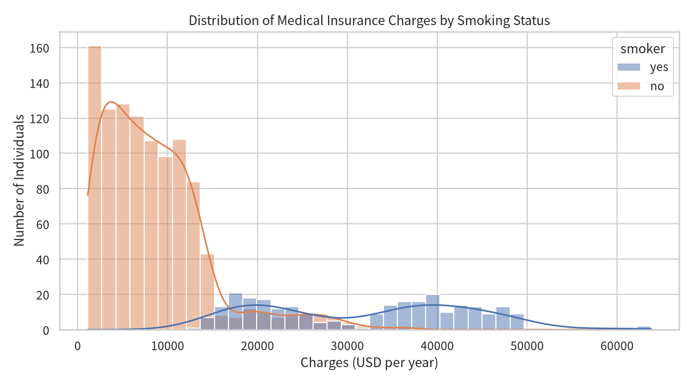
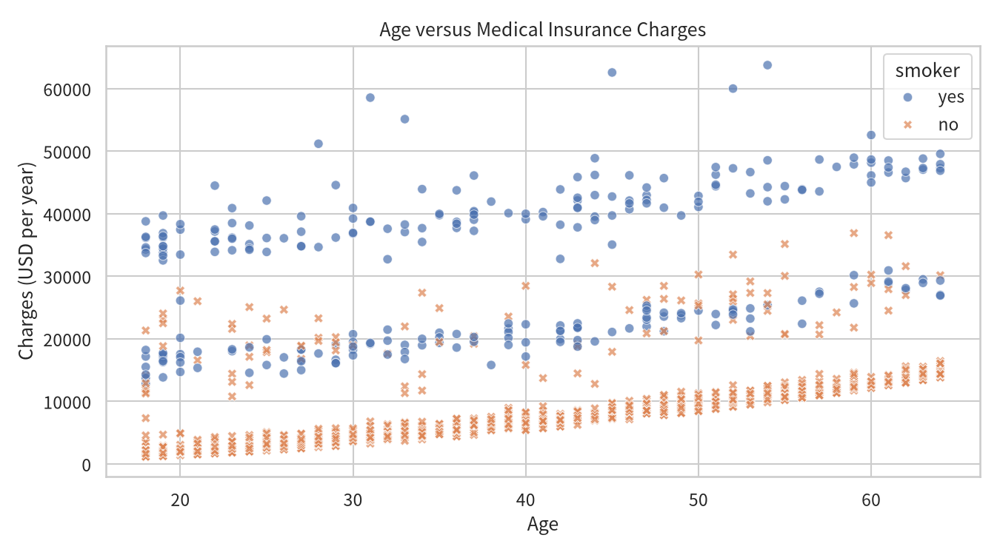

# NG SAM NEI — Data Science Portfolio

## About Me

I am a data science student at the **University of Macau**, currently completing the CISC7204 Data Science course. I enjoy turning raw datasets into clear questions, reproducible analyses, and visualizations that non-technical readers can understand. This portfolio collects the projects I have built with Python and GitHub.

## Technical Skills

- **Programming:** Python — Pandas, NumPy, Matplotlib, Seaborn, Scikit-learn
- **Analytics:** data cleaning and wrangling, exploratory data analysis (EDA), regression modelling, model evaluation
- **Tools:** Jupyter Notebook, Git, GitHub, GitHub Pages
- **Other:** data visualization, reproducible reporting, Markdown

## Project Showcase

### Medical Insurance Cost Analysis

**Research Question:** What demographic and lifestyle factors drive individual medical insurance charges, and how accurately can a multiple linear regression model predict them?

The first figure compares the distribution of annual charges for smokers and non-smokers. Non-smokers are concentrated below USD 15,000, while smokers occupy a much higher charge band. On average, smokers are charged about **3.8 times more** than non-smokers (around USD 32,050 versus USD 8,440 per year), making smoking the strongest driver of insurance charges.

The second figure plots charges against age. Charges rise with age in three parallel bands, and the upper band is made up almost entirely of smokers. A multiple linear regression model using all available variables explains about **81% of the variation** in held-out charges (R² = 0.807), with a mean absolute error of about USD 4,180.

**Key findings:**

1. Smoking status is the dominant predictor of charges (correlation 0.79).
2. Age and BMI both increase charges, with regional and gender effects being small.
3. The linear model captures the overall trend but cannot reproduce the nonlinear bands, which is the main limitation noted in the project.

**Project status:** Completed

**Project repository:** <https://github.com/mc653292/data-science-project>

## Contact

- **University of Macau** — Student ID: MC653292
- **GitHub:** <https://github.com/mc653292>
